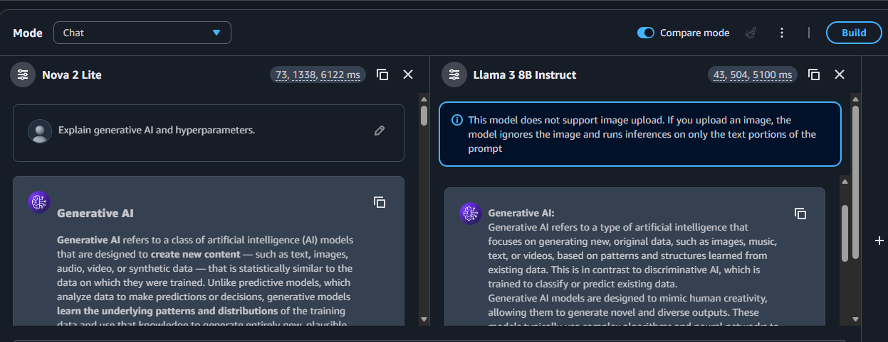
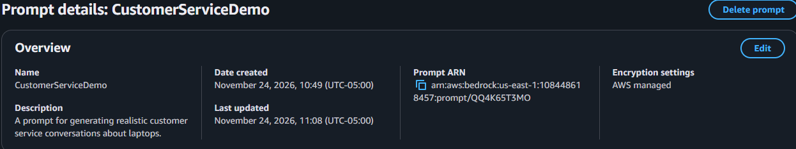

## ☁️ AWS SimuLearn: Exploring Amazon Bedrock Playgrounds

### 📖 Overview
The AnyCompany business team wants to identify the most effective AI model for its customer service chat experience but lacks a structured approach for evaluating available options. To address this challenge, this lab explored Amazon Bedrock and its role in generative AI development by providing hands-on experience with foundation models (FMs). Activities included using Bedrock Playgrounds to evaluate model responses, configuring inference parameters, comparing outputs from multiple models, and leveraging Prompt Management to create, test, and version reusable prompts. These exercises provided practical experience in model selection and evaluation while demonstrating how AWS-managed AI services can support real-world customer support and conversational AI solutions.

### 🛠️ Amazon Bedrock Components
| Services, Models & Features | Description |
|----------------------------|-------------|
| Amazon Bedrock | Managed service for building and deploying generative AI applications with foundation models. |
| Bedrock Playgrounds | Interactive environment for testing prompts, evaluating model responses, and comparing foundation models. |
| AWS Nova Lite 2 | Foundation model used for text generation and prompt experimentation. |
| Llama 3 8B | Foundation model used for conversational AI and response comparison. |
| Prompt Management | Feature for creating, versioning, and reusing prompts across AI workflows. |
| Prompt Engineering | Practice of designing effective prompts to improve model outputs. |
| Foundation Models (FMs) | Pre-trained AI models that power generative AI applications. |
| Generative AI | AI technology for generating text and other content from user inputs. |
| AWS Management Console | Web-based interface for configuring and managing AWS services. |

### 💡 Key Takeaways
- Learned how system prompts provide instructions and context that guide Foundation Model (FM) responses.
- Explored how inference parameters such as temperature and reasoning influence response accuracy, creativity, and variability.
- Developed prompt engineering skills to improve the quality and effectiveness of model outputs.
- Used Prompt Management to create, version, and reuse prompts across generative AI workflows.
- Compared Foundation Models (FMs) to evaluate response quality and determine suitability for different use cases.
- Applied test variables to validate prompt performance across multiple input scenarios.
- Learned how draft versions support iterative prompt refinement, testing, and deployment readiness.
- Observed Nova Lite 2's reasoning capability, which generated intermediate reasoning before producing the final response to a mathematical prompt. - Observed Nova Lite 2's reasoning capability during prompt execution. [Nova 2 Reasoning](nova_2_reasoning.txt)
- Gained foundational knowledge of how Amazon Bedrock supports generative AI application development.

#### Model Reasoning Demonstration

*Figure: Nova Lite 2 displaying its reasoning process before generating the final response for a tip-calculation prompt.*

#### Prompt Configuration Details

*Figure: Amazon Bedrock Prompt Management displaying prompt configuration details, variables, and settings used to create and evaluate reusable prompts.*

### 🌎 Real-World Applications
- AI-powered customer support.
- Intelligent virtual assistants.
- Business process automation.
- Knowledge retrieval and information assistance.
- Generative AI solutions for enterprise environments.

### 🎓 Learning Resource
AWS Skill Builder: [AWS SimuLearn – Explore the Amazon Bedrock Playgrounds](<https://skillbuilder.aws/learn/YZDUMAQABG/aws-simulearn-explore-the-amazon-bedrock-playgrounds/88NAE39D3Z?parentId=BFKGA5VM8H>)